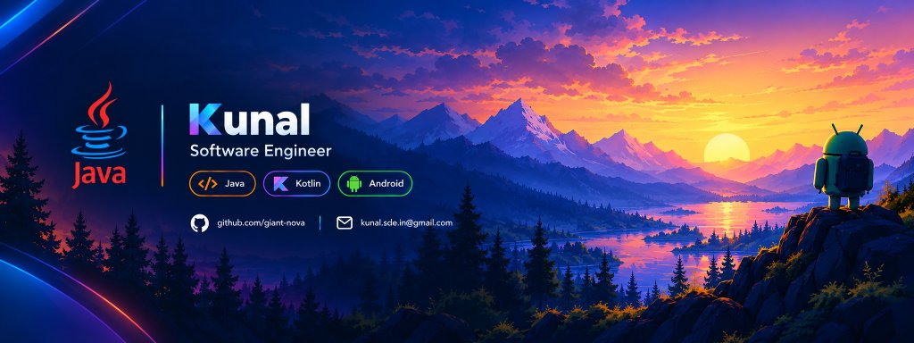

  

[;Distributed+Systems+%26+DOOH+Players;Backend+%26+Edge+AI+Architectures)](https://git.io/typing-svg)

  
  
  

+Role:+SDE-1+%40+JustBaat+Mediatech;>+Stack:+Kotlin+%7C+Compose+%7C+Spring+Boot+%7C+Kafka;>+Focus:+Scalable+client-side+%26+distributed+systems" alt="Terminal Status" />

---

### ⚡ Production Impact & Highlights

| 📱 **1,000+** | ⏱️ **99.9%** | 🚀 **2 Apps** | 📈 **98%** | ⚡ **40%** |
| :---: | :---: | :---: | :---: | :---: |
| DOOH Screens in Prod | Player Uptime | Live on Google Play | Ad Fill Rate | Latency Cut |

---

### 💫 What I Do

- 🏢 **SDE-1 at JustBaat Mediatech**: Scaling VisionPlay DOOH player applications across Android, Linux, Windows, and Samsung Tizen OS with distributed CMS synchronization and remote zero-downtime auto-updates.
- 📱 **Native Android Engineering**: Crafting modern mobile architectures with 100% Jetpack Compose, unidirectional data flow (UDF), Coroutines, Room DB, and offline-first design.
- ⚙️ **Distributed & High-Throughput Backends**: Building event-driven architectures with Spring Boot, PostgreSQL, Kafka, and Redis, backed by Prometheus/Grafana observability.
- 🎓 **Education**: B.E. in Information Technology, Panjab University (UIET), Chandigarh (2021 – 2025).

---

### 📱 Production Mobile Apps & Device Showcases

<table>
  <tr>
    <th width="50%" align="center">
      <h3>🕹️ XO Rush: 2 Player Tic Tac Toe</h3>
    </th>
    <th width="50%" align="center">
      <h3>💰 Mysa Money — Expense & Budget</h3>
    </th>
  </tr>
  <tr>
    <td align="center" valign="top">
      
        
      
        
      <b>100% Jetpack Compose • Firebase Real-Time • Minimax AI</b>
        
      

        <ul>
          <li><b>Architecture:</b> 5-module structure with Unidirectional Data Flow (UDF) & Coroutines.</li>
          <li><b>Multiplayer:</b> Serverless real-time sync with Firebase Realtime DB & disconnect grace handling.</li>
          <li><b>AI Engine:</b> Minimax with Alpha-Beta pruning for dynamic N×N grid gameplay.</li>
          <li><b>Monetization:</b> 38-placement ad pipeline with Firebase Remote Config orchestration.</li>
        </ul>
      

       
      
    </td>
    <td align="center" valign="top">
      
        
      
        
      <b>Offline-First MVVM • Gemini AI Coach • ML Kit OCR</b>
        
      

        <ul>
          <li><b>Scale & UI:</b> 7K+ LOC, 20+ screens, 10 ViewModels, Material 3 design system.</li>
          <li><b>AI Capabilities:</b> Gemini AI financial coach + Google ML Kit receipt scanning.</li>
          <li><b>Data & Sync:</b> Offline-first Room database with Google Drive OAuth2 sync.</li>
          <li><b>Monetization:</b> Google Play Billing freemium subscription & iText PDF reporting.</li>
        </ul>
      

       
      
    </td>
  </tr>
</table>

---

### 🛡️ Distributed Systems & Edge AI Projects

#### [AI-Driven Industrial Safety Ecosystem](https://github.com/giant-nova/Java-DMAISE-edge-AI)
> **Real-time anomaly detection, worker safety tracking, and alerting pipeline.**
- **Event Streaming**: Kafka message bus integrated with LangChain4j and Gemini models for edge anomaly detection and alerting.
- **Real-Time Push**: JWT-secured WebSocket pipeline & FCM push alerts connected to a companion Android app.
- **DevOps & Observability**: Multi-container Docker stack with Prometheus metrics collection and Grafana dashboards for AI latency tracking.
- **Stack**: `Java` `Spring Boot` `Kafka` `Redis` `PostgreSQL` `Docker` `Prometheus` `Grafana`

---

### 💻 Tech Stack

  

<b>📱 Mobile & Android</b>

 

<b>⚙️ Backend, Messaging & Cloud</b>

 

<b>🤖 AI, Google Services & Observability</b>

 

---

### 🐍 Contribution Activity

<picture>
  <source media="(prefers-color-scheme: dark)" srcset="https://raw.githubusercontent.com/giant-nova/giant-nova/output/github-contribution-grid-snake-dark.svg">
  <source media="(prefers-color-scheme: light)" srcset="https://raw.githubusercontent.com/giant-nova/giant-nova/output/github-contribution-grid-snake.svg">
  
</picture>

---

